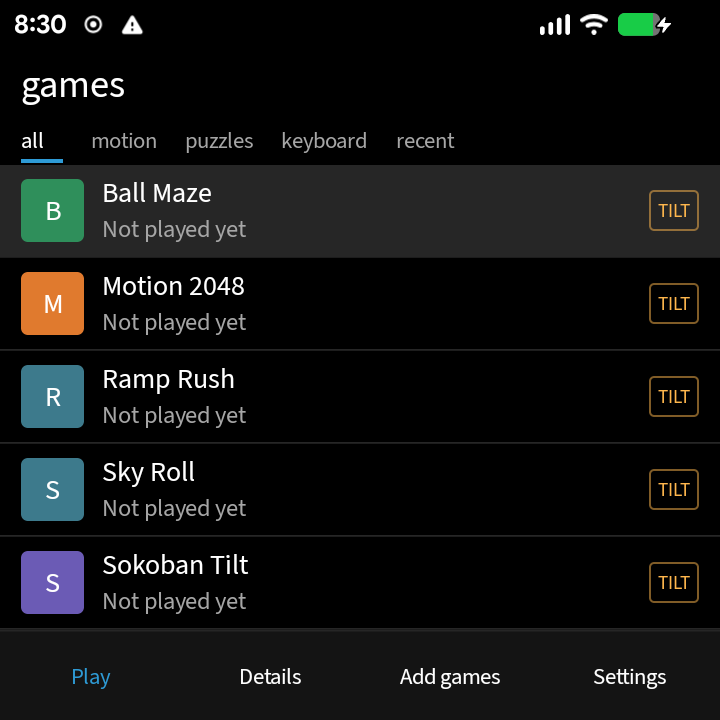
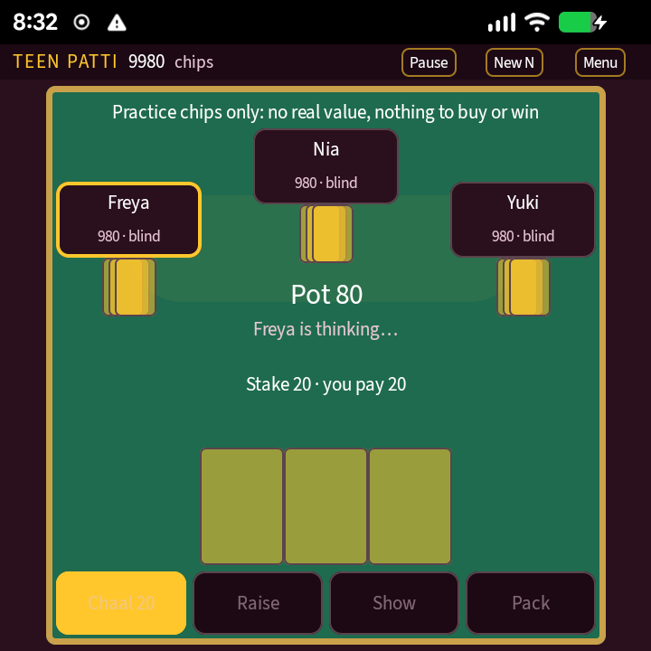
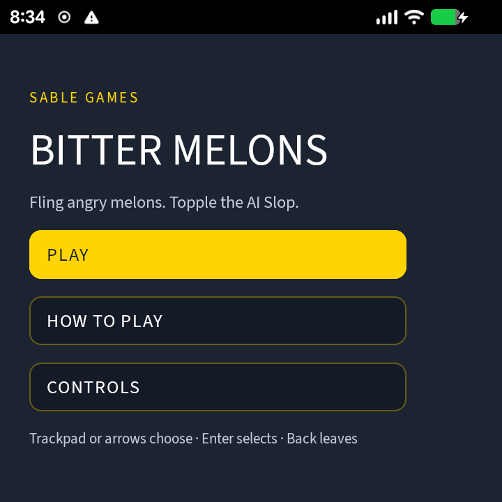
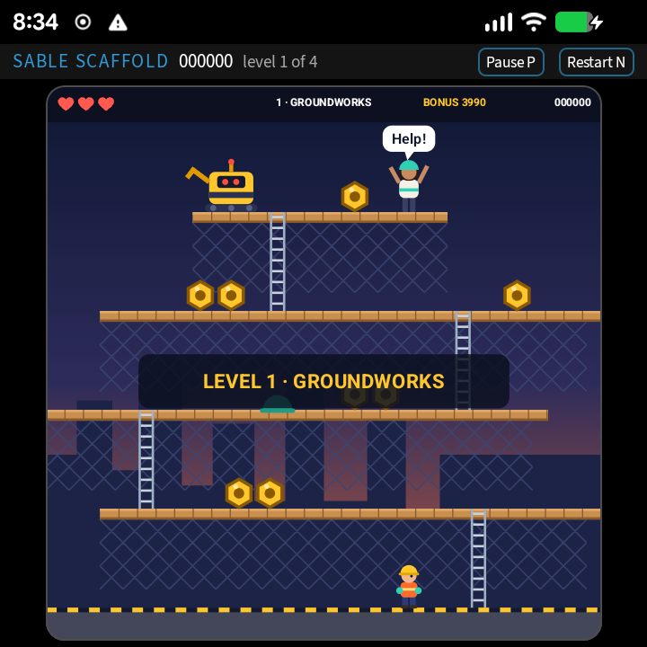
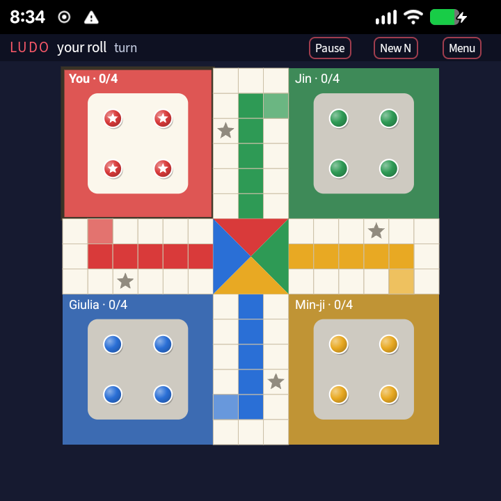
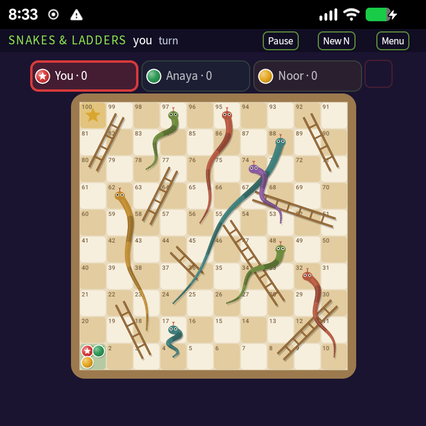

# Sable Games

[](https://github.com/aimindseye/sablegames/actions/workflows/android.yml)
[](https://github.com/aimindseye/sablegames/actions/workflows/security.yml)
[](https://sonarcloud.io/summary/new_code?id=aimindseye_sablegames)
[](LICENSE)
[](docs/USER_GUIDE.md#install)
[](docs/USER_GUIDE.md#your-phone)

Keyboard-first games for BlackBerry-style Android phones: the Zinwa Q25 and the Unihertz Titan 2, and any other phone with a hardware keyboard. They play from the keys and the trackpad, and also by touch. They were first written for [SableOS](https://github.com/aimindseye/zinwaq25-sableos) and live here so they install on stock firmware too, with no SableOS and no Sable launcher.

**Latest release: [2.0.0](docs/releases/v2.0.0.md)**: seventeen apps, including the new Gravel & Gears and three new Bitter Melons worlds.

## The apps

Each game is its own app, so you install only the ones you want.

| App | Package | What it is |
| --- | --- | --- |
| Sable Games Console | `io.github.aimindseye.sablegames.console` | Plays games written as small Lua scripts, so new games can be added without a new build. Ships with eight tilt games |
| Sable Card Games | `io.github.aimindseye.sablegames.cards` | Ten Indian card games in one app: Teen Patti (practice chips only), Indian Rummy, Mendicot, Callbreak, Judgement, 2-3-5, Bluff, Donkey, Gulam Choor and Filmi Rummy |
| Sable Snakes & Ladders | `io.github.aimindseye.sablegames.snakesladders` | Two to four players, exact finish |
| Sable Ludo | `io.github.aimindseye.sablegames.ludo` | Four colours: bring your tokens home |
| Sable Scaffold | `io.github.aimindseye.sablegames.scaffold` | Climb the site, dodge rolling hazards, rescue Juno |
| Bitter Melons | `io.github.aimindseye.sablegames.melons` | Fling angry melons from a slingshot and topple the AI Slop. Four worlds: 36 levels |
| Gravel & Gears | `io.github.aimindseye.sablegames.gravelgears` | Nonstop downhill mountain biking: steer with the trackpad, keys or tilt, fire cards as moves, hit the gates, draft new cards. Day and Night Ride trails, three riders |
| Tartarus Breach | `io.github.aimindseye.sablegames.tartarus` | First-person arena roguelite in the Underworld: fight down four Gates of Tartarus with four mythic artifacts, draft Olympian Boons between waves and seal each Gate by felling its Guardian. W A S D, J L and the trackpad (or touch) play it. New in the next release; its package name is not registered yet |
| Sable Sudoku | `io.github.aimindseye.sablegames.sudoku` | Fill the 9 x 9 grid |
| Sable Minesweeper | `io.github.aimindseye.sablegames.minesweeper` | Clear the field without hitting a mine |
| Sable 2048 | `io.github.aimindseye.sablegames.game2048` | Slide tiles to merge them up to 2048 |
| Sable Bricks | `io.github.aimindseye.sablegames.bricks` | Break the wall with the ball |
| Sable Snake | `io.github.aimindseye.sablegames.snake` | Eat to grow; don't hit a wall or yourself |
| Sable Blocks | `io.github.aimindseye.sablegames.blocks` | Falling blocks: fill whole rows to clear them |
| Sable Reversi | `io.github.aimindseye.sablegames.reversi` | Play dark against the phone |
| Sable Solitaire | `io.github.aimindseye.sablegames.solitaire` | Klondike, one card at a time |
| Sable Mahjong | `io.github.aimindseye.sablegames.mahjong` | Remove matching free tiles in pairs |
| Sable Words | `io.github.aimindseye.sablegames.words` | Guess the five-letter word in six tries |

<p>






</p>

Each game reads which phone it runs on and fits its keys to it: the Q25's trackpad, or I J K L on the Titan 2, which has no arrows (see the [User Guide](docs/USER_GUIDE.md#your-phone)). Coming next: an installer that sets up the games you pick in one go.

## Install

Download the APKs from [Releases](https://github.com/aimindseye/sablegames/releases) and open each one on the phone, or install them from a computer with `adb install <file>.apk`. Each release lists the SHA-256 of every APK in `SHA256SUMS.txt`.

The games need Android 11 or later. They ask for no permissions (only the app-private one AndroidX adds for its own receivers): no internet, no storage, no location. The console reads only the folder you pick when you add Lua games.

## Lua games are sandboxed

A console game is a folder with a `game.toml` and one `.lua` script (and up to 32 PNG pictures). Games run with Lua's basic, text, table and maths libraries only. They can't read or write files, use the network, run other programs or see your data. A game stuck in a loop, a runaway text search or one that eats memory is stopped with a message, and one game can't change another. The rules are tested in `games/src/testConsole`.

## Documentation

- [User Guide](docs/USER_GUIDE.md): installing, and how to play every game, with its keys.
- [Writing a Lua game: tutorial](docs/GAMES_CONSOLE_TUTORIAL.md), including what a game can and can't do to the phone.
- [Games Console reference](docs/GAMES_CONSOLE.md): every call a game can make.
- [Releasing](docs/RELEASING.md): signing on your computer, publishing, and the package names.
- [Release notes](docs/releases/): what changed in each version, from [1.0.0](docs/releases/v1.0.0.md) to the latest, [2.0.0](docs/releases/v2.0.0.md).
- [Phone checks](docs/PHONE_CHECKS.md): the checks run by hand on a phone.

## Build

You need JDK 17 and the Android SDK (platform 36). Then:

```
./gradlew :games:assembleSudokuRelease          # one game
./gradlew assembleRelease                        # every game
./gradlew :design:testDebugUnitTest :games:testSudokuDebugUnitTest :games:testConsoleDebugUnitTest \
    :games:testCardsDebugUnitTest :games:testMelonsDebugUnitTest
```

Release APKs build unsigned; releases are signed on the owner's computer with `tools/build-release.sh`, which asks for the keystore password and stores it nowhere (see [docs/RELEASING.md](docs/RELEASING.md)). Dependencies are pinned with Gradle lockfiles and `gradle/verification-metadata.xml`.

## Layout

| Path | What's there |
| --- | --- |
| `games/` | One Gradle module, one product flavor per app. `src/main` is shared (including Bitter Melons' sprites in `res/drawable-nodpi`); `src/<flavor>` holds each app's icon, and `src/console` the Lua console and its games |
| `docs/` | The guides, release notes, and Bitter Melons' level data (`docs/bitter-melons/levels.json`) |
| `design/` | The Sable look: colours, type, list keys and the shared components |
| `.github/workflows/` | Build and test, security scans and SonarQube Cloud |
| `tools/` | `build-release.sh` (signed release on your computer), `check-apks.sh`, `screenshots.sh` (captures every game from a phone over adb for the docs), and `melons/cut_sprites.py` (cuts Bitter Melons' sprites from the art sheets), `tartarus/` (`cut_sprites.py` converts Tartarus Breach's art, `gen_data.py` turns its JSON into `TartarusData.kt`), and `gravelgears/` (`cut_sprites.py` cuts Gravel & Gears' art, `gen_data.py` turns its card and stage JSON into `GravelGearsData.kt`) |

## Licence

Apache-2.0, see [LICENSE](LICENSE) and [NOTICE](NOTICE). LuaJ and the Phosphor icon glyphs are MIT and JBox2D is BSD-2-Clause; see [THIRD_PARTY_NOTICES.md](THIRD_PARTY_NOTICES.md).
