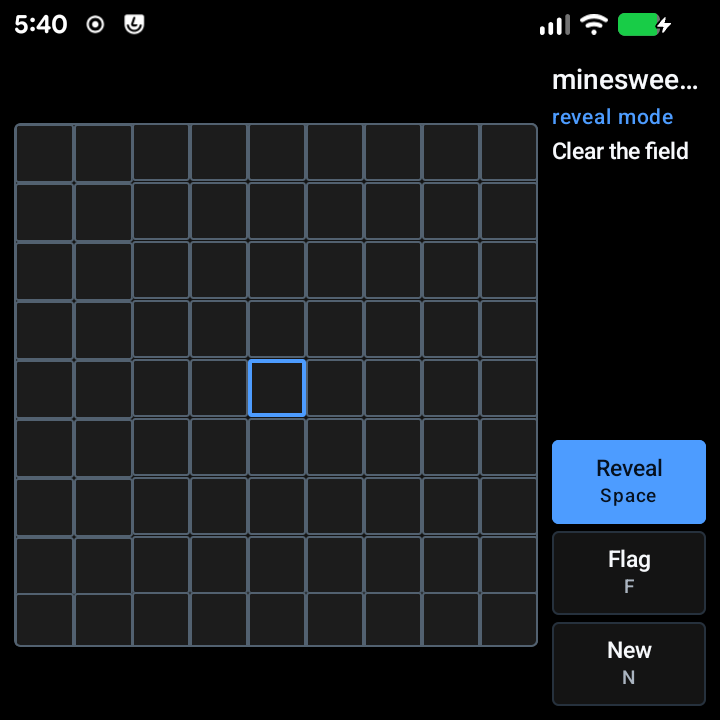
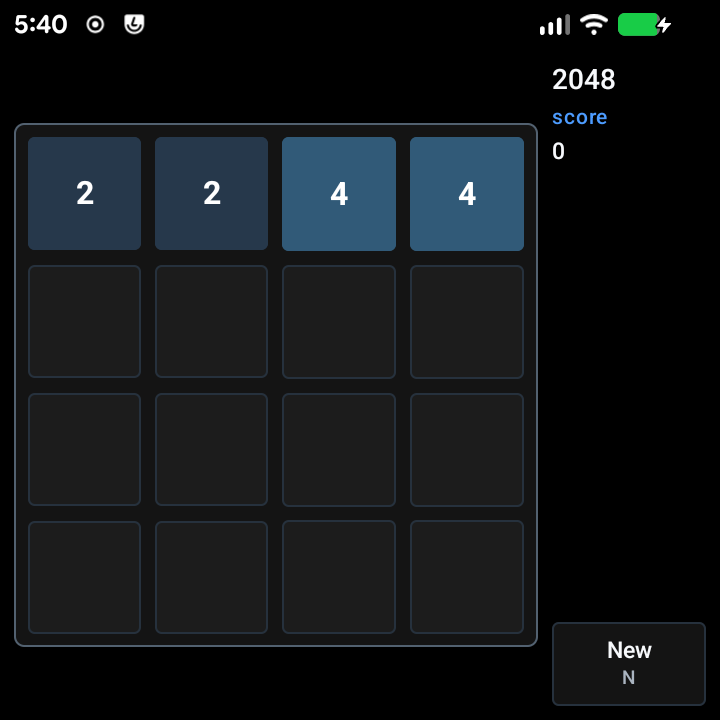
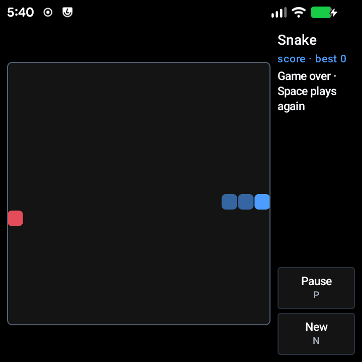
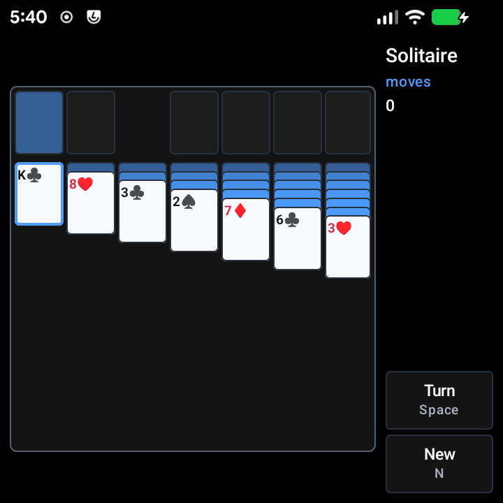
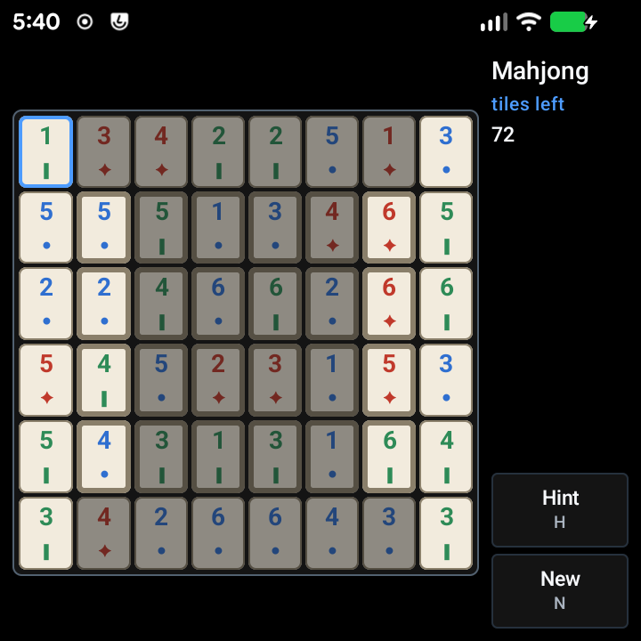
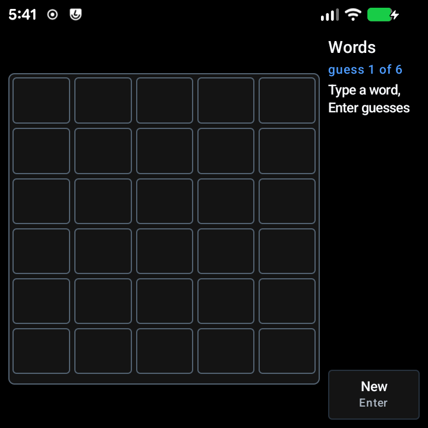

# Sable Games: User Guide

How to install and play Sable Games on a keyboard phone such as the Zinwa Q25. Writing your own Lua games is in [GAMES_CONSOLE_TUTORIAL.md](GAMES_CONSOLE_TUTORIAL.md) and the reference in [GAMES_CONSOLE.md](GAMES_CONSOLE.md).

## Install

Download the APKs you want from [Releases](https://github.com/aimindseye/sablegames/releases). On the phone, open each one and allow your file manager or browser to install apps when Android asks. From a computer, `adb install sable-sudoku-v0.1.0.apk` does the same. `SHA256SUMS.txt` on the release page lists each file's SHA-256, so you can check a download with `sha256sum -c SHA256SUMS.txt`.

The games need Android 11 or later and ask for no permissions. Each one is a separate app, so remove one from Settings > Apps like any other.

## Keys in every game

| Key | Does |
| --- | --- |
| Arrows or the trackpad | Move |
| Space or Enter (trackpad click) | The main action: reveal, play, pick, launch |
| N | New game (in Words, Enter starts the next round once one is done) |
| P | Pause, in the games that move by themselves |
| U | Undo, where the game allows it |
| Back | Leaves the game |

The digit keys in Sudoku are the letters with digits printed on them on the Q25 (W E R S D F Z X C for 1 to 9). On any keyboard, a typed digit also works, such as Alt plus the key that shows it. 0 or Del erases.

## Games

Every game plays from the keyboard or the trackpad (which sends arrow keys), and also by touch. N starts a new game in all of them except Words, where every letter types; there Enter starts the next round once one is done.

| Game | How to play | Keys |
| --- | --- | --- |
| Sudoku | Fill the 9 x 9 grid | Arrows move; W E R S D F Z X C (or Alt+digits) enter 1-9; Del erases; U undoes |
| Minesweeper | Clear the field without hitting a mine | Arrows move; Space reveals; F flags |
| 2048 | Slide tiles to merge them up to 2048 | Arrows slide |
| Bricks | Break the wall with the ball; three lives, each level faster | Left/right move the paddle; Space launches; P pauses |
| Snake | Eat to grow; don't hit a wall or yourself | Arrows turn; P pauses; Space restarts after a crash |
| Blocks | Falling blocks: fill whole rows to clear them | Left/right move; Up rotates; Down drops one row; Space drops; P pauses |
| Reversi | Play dark against the phone; flip its pieces by closing lines | Arrows move; Space or Enter plays |
| Solitaire | Klondike, one card at a time | Arrows pick a pile; Enter picks up and puts down; Space turns the stock; A sends a card to its foundation; Del lets go |
| Mahjong | Remove matching free tiles in pairs; every deal can be cleared | Arrows move; Space or Enter picks; H shows a pair |
| Words | Guess the five-letter word in six tries: green is right, amber is in the word elsewhere | Type the letters; Del erases; Enter guesses |

## Sable Card Games

Sable Card Games opens on a menu of ten Indian card games. Arrows or the trackpad choose a game, Enter opens it and Back returns to the menu. In every game the arrows move, Enter confirms, Space selects, Del cancels and N starts over; touch works too. You play against phone players, and their names are drawn from names all over the world. Teen Patti uses practice chips only: they can't be bought, sold or won as anything else.

| Game | How to play | Keys |
| --- | --- | --- |
| Teen Patti | Three-card brag against three phone players, with practice chips only: they cannot be bought, sold or won as anything else. Play blind or look; chaal, raise, pack, or ask for a show | Left/Right and Enter choose; C chaal, R raise, T show, P pack, L look |
| Indian Rummy | 13 cards, two decks, a wild joker for the round. Declare with two sequences (one pure) and the rest in sets or sequences; a wrong declaration costs 80 points | Z draws from the stock, X takes the open card; Space picks a card up, then arrows move it; Enter throws; M declares; G groups your melds; O sorts |
| Filmi Rummy | The same rules as Indian Rummy with an original film theme: four invented roles in place of the suits and "plot twist" jokers. No real people or films | As Indian Rummy |
| Mendicot | Four players in partnerships, hidden trump (shown when someone cannot follow suit); win the tens | Left/Right choose a card; Enter plays |
| Callbreak | Bid the tricks you will win, over five rounds; spades are always trump | Up/Down set the bid; Left/Right and Enter play |
| Judgement | Bid exactly the tricks you will win; the trump suit changes every round and the last bidder may not make the bids add up | As Callbreak |
| 2-3-5 | Three players aim for 5, 3 and 2 tricks; the 5 player picks trump after the first five cards | Left/Right choose a suit or a card; Enter confirms |
| Bluff | Put cards down as the rank whose turn it is; call a bluff when you doubt it | Space picks up to four cards; Enter puts them down; B calls; Del clears |
| Donkey | Pass cards to get four of a kind, then grab a spoon before the others; the one left without gets a letter of D-O-N-K-E-Y | Left/Right choose; Enter passes; Space grabs |
| Gulam Choor | Take cards from the next player and throw pairs; whoever keeps the odd Jack loses | Left/Right choose a card; Enter takes it |

## Snakes & Ladders and Ludo

Each is an app of its own and opens straight into the game. Back leaves the app.

| Game | How to play | Keys |
| --- | --- | --- |
| Snakes & Ladders | 8 x 8 board, two to four players, exact finish | Space rolls; 2, 3, 4 set the number of players |
| Ludo | Four colours (you are red): a six brings a token out; capture, sixes and reaching home roll again | Space rolls and moves; Left/Right choose a token |

## Sable Games Console

Sable Games Console plays games written as small Lua scripts, so new games can be added to the phone without rebuilding the app. It comes with eight games you play by tilting the phone. Each also plays with the trackpad, the arrow keys or W A S D.

| Game | How to play | Keys |
| --- | --- | --- |
| Tilt Maze | Roll the ball through the maze to the green square | Tilt, trackpad or W A S D roll; Space starts the level over |
| Motion 2048 | Every tile slides the way you tilt; equal tiles merge. One tilt, one slide | Tilt, trackpad or W A S D slide; level the phone between slides |
| Sokoban Tilt | Walk and push the crates onto the marks. One tilt, one step | Tilt, trackpad or W A S D walk; U undoes a step; Space starts the level over |
| Tilt Racer | Steer through the traffic without crashing; it gets faster the further you go | Tilt, or hold Left/Right (trackpad, A and D), to steer; Space boosts; C changes the colour of your F1 car, and the console remembers it |
| Tilt Circuit | Three laps against two rival cars, on the Easy oval (for starters, with slower rivals) or the Twisty circuit, chosen in a menu before each race and remembered; the menu shows your best time on each, and the library keeps your fastest race in seconds. The grass slows you down, and laps only count when you go all the way round | In the menu Up/Down picks a circuit and Space starts. Tilt, or hold Left/Right, to steer; lean back or hold Down (S) to brake; C changes the colour of your car |
| Ball Maze | Steel balls in a maze under a clear lid, like the hand-held toy: roll every ball into the middle at the same time. A menu picks a round or square board, plastic or wood, and Easy (2 balls) to Expert (5 balls); each game makes a new maze, and the library keeps your fastest time in seconds | Tilt, or hold the arrows (W A S D), to roll the balls; in the menu Up/Down and Left/Right choose and Space starts; N makes a new maze and M goes back to the menu |
| Sky Roll | Roll a ball across stone platforms floating in the sky: pick up the gems and reach the goal before the time runs out. Eight levels add bridges, wind that pushes you sideways, moving lifts and rails; roll off an edge and you lose one of four balls. The score is the gems and the seconds left | Tilt, or hold the arrows (W A S D), to roll; R starts the level again |
| Ramp Rush | A stunt car seen from behind, racing through a desert canyon at sunset. Ramps throw it over the gaps; in the air, leaning rolls the car, and each full roll you land takes a second off your time. Land on your wheels or go back to the last checkpoint. Three tracks; the library keeps your fastest total in seconds | Tilt, or hold Left/Right (A and D), to steer and to roll in the air; lean back or hold Down (S) to brake; Space boosts when the boost bar is full enough (landed rolls fill it); C changes the colour of your car |

**The library.** Left and Right switch between the all, motion, puzzles, keyboard and recent tabs; Up and Down pick a game, and Space or Enter plays it. Each row shows the game's best score and a TILT or KEYS tag. I opens a game's details (best score, Reset progress, Remove for a game you added), A opens Add games and S opens Settings.

**Hold it how you'll play.** Before a tilt game starts, hold the phone the way you want to play and press Space: that angle becomes level, so you can play sitting up, lying back or with the phone flat on a table. K plays with the keys instead. One lean makes one step, and the next step needs the phone back near level, so a game never runs away from you.

**Pause.** Back (or P in a tilt game) pauses. The pause menu has a letter for each choice: R resume, N new game, L level again from where you are, T tilt sensitivity, K play with keys, Q quit to the library.

**Settings** (S in the library): T cycles tilt sensitivity (Low, Mid or High: a full turn takes a lean of about 45, 32 or 22 degrees; Mid is the default). A small wobble of the hand doesn't steer, and steering is gentle near level, so small leans make small corrections and K switches Play with keys on or off. The motion sensor is used only while a tilt game or the levelling screen is showing.

**Adding games.** Copy a game's folder to the phone, then in the library press A and choose the folder that holds it (or a folder of several games) in the system's folder picker. The app needs no storage permission: it only reads the folder you pick. It lists each game it finds; Enter adds one, and a game with a mistake shows what is wrong and on which line instead. Added games are copied into the app, so the folder can be deleted afterwards.

Each game is a folder with two files: `game.toml`, which names it (`id`, `name`, `entry`, and optionally `shelf`, `input`, `best`, `summary` and `controls`), and one `.lua` script, and it may also hold PNG pictures the game draws (up to 32, each at most 512 by 512 pixels). Games run in a sandbox with Lua's basic, text, table and maths libraries only: they cannot read or write files, use the network, run other programs or see your data. A game stuck in a loop, a runaway text search or a game that eats memory is stopped with a message, without harming the phone, and one game cannot change another or read its saves. Adding a game only copies its `game.toml`, its script and its PNG pictures into the console; nothing is installed. To make your own, follow the [step-by-step tutorial](GAMES_CONSOLE_TUTORIAL.md), which builds a small game and lists what games can and can't do; the full list of what a script can call is in [GAMES_CONSOLE.md](GAMES_CONSOLE.md).

