# Sable Games: User Guide

How to install and play Sable Games on a keyboard phone such as the Zinwa Q25. Writing your own Lua games is in [GAMES_CONSOLE_TUTORIAL.md](GAMES_CONSOLE_TUTORIAL.md) and the reference in [GAMES_CONSOLE.md](GAMES_CONSOLE.md).

## Install

Download the APKs you want from [Releases](https://github.com/aimindseye/sablegames/releases). On the phone, open each one and allow your file manager or browser to install apps when Android asks. From a computer, `adb install sable-sudoku-1.0.0.apk` does the same. `SHA256SUMS.txt` on the release page lists each file's SHA-256, so you can check a download with `sha256sum -c SHA256SUMS.txt`.

The games need Android 11 or later and ask for no permissions. Each one is a separate app, so remove one from Settings > Apps like any other.

## Keys in every game

| Key | Does |
| --- | --- |
| Arrows or the trackpad | Move |
| I J K L, on a phone without arrows (the Titan 2) | Move: I up, J left, K down, L right |
| Space or Enter (trackpad click) | The main action: reveal, play, pick, launch |
| N | New game (in Words, Enter starts the next round once one is done) |
| P | Pause, in the games that move by themselves |
| U | Undo, where the game allows it |
| Back | Leaves the game |

The digit keys in Sudoku are the letters with digits printed on them: W E R S D F Z X C for 1 to 9 on the Q25, and W E R S D F X C V on the Titan 2. On any keyboard, a typed digit also works, such as Alt plus the key that shows it. 0 (Alt+Q on the Titan 2) or Del erases.

### Your phone

Each game reads which phone it runs on when it starts, and fits its keys to that phone. The screen needs nothing extra: the Q25's 720 x 720 and the Titan 2's 1440 x 1440 both get the square layout, with the board on the left and the controls beside it.

| Phone | Move with | Sudoku digits |
| --- | --- | --- |
| Zinwa Q25 | The trackpad or arrows | W E R S D F Z X C, or Alt+ those |
| Unihertz Titan 2 | I J K L (it has no arrows or trackpad) | W E R S D F X C V, or Alt+ those |
| Another phone with a keyboard but no arrows | I J K L | A typed digit |
| Any other phone | Arrows, if it has them, and touch | A typed digit |

On a phone that moves with I J K L, Words still types every letter, and Teen Patti's Look is S instead of L. Sable Games Console's tilt games move with W A S D on every phone.

## Games

Every game plays from the keyboard or the trackpad (which sends arrow keys), and also by touch. N starts a new game in all of them except Words, where every letter types; there Enter starts the next round once one is done.

| Game | How to play | Keys |
| --- | --- | --- |
| Sudoku | Fill the 9 x 9 grid | Arrows move; W E R S D F Z X C (or Alt+digits) enter 1-9; Del erases; U undoes |
| Minesweeper | Clear the field without hitting a mine | Arrows move; Space reveals; F flags |
| 2048 | Slide tiles to merge them up to 2048 | Arrows slide |
| Bricks | Break the wall with the ball; three lives, each level faster | Left/right move the paddle; Space launches; P pauses |
| Snake | Eat to grow; don't hit a wall or yourself | Arrows turn; P pauses; Space restarts after a crash |
| Blocks | Falling blocks: fill whole rows to clear them | Left/right move; Up rotates; Down drops one row; Space drops; P pauses |
| Reversi | Play dark against the phone; flip its pieces by closing lines | Arrows move; Space or Enter plays |
| Solitaire | Klondike, one card at a time | Arrows pick a pile; Enter picks up and puts down; Space turns the stock; A sends a card to its foundation; Del lets go |
| Mahjong | Remove matching free tiles in pairs; every deal can be cleared | Arrows move; Space or Enter picks; H shows a pair |
| Words | Guess the five-letter word in six tries: green is right, amber is in the word elsewhere | Type the letters; Del erases; Enter guesses |
| Scaffold | Climb the building site to rescue Juno, jumping the pipes and rivets Clunk rolls down; three hearts, four levels | A left, K right, T up, V down, Space jumps (arrows and the trackpad too, where the phone has them); P pauses; keys can be changed |
| Bitter Melons | Fling melons from the slingshot and break every piece of AI Slop; see [below](#bitter-melons) | Up/down aim; left/right set the power; Space fires, and again in the air for a Seed Burst; V looks ahead; R restarts the level; P pauses |

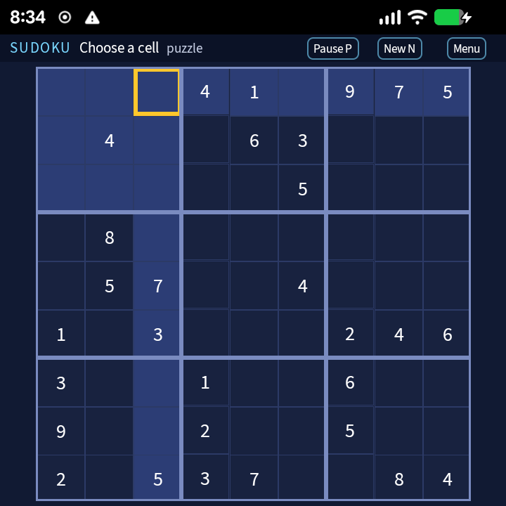

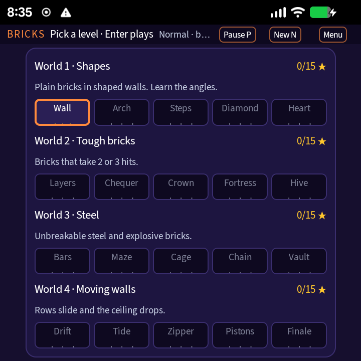

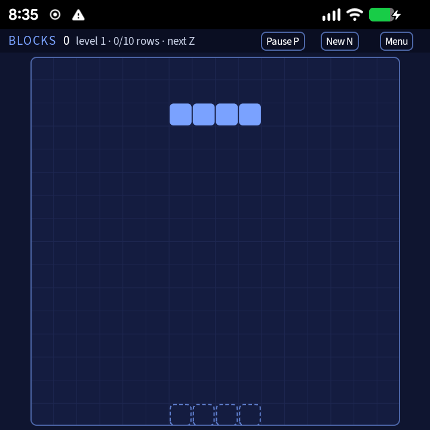
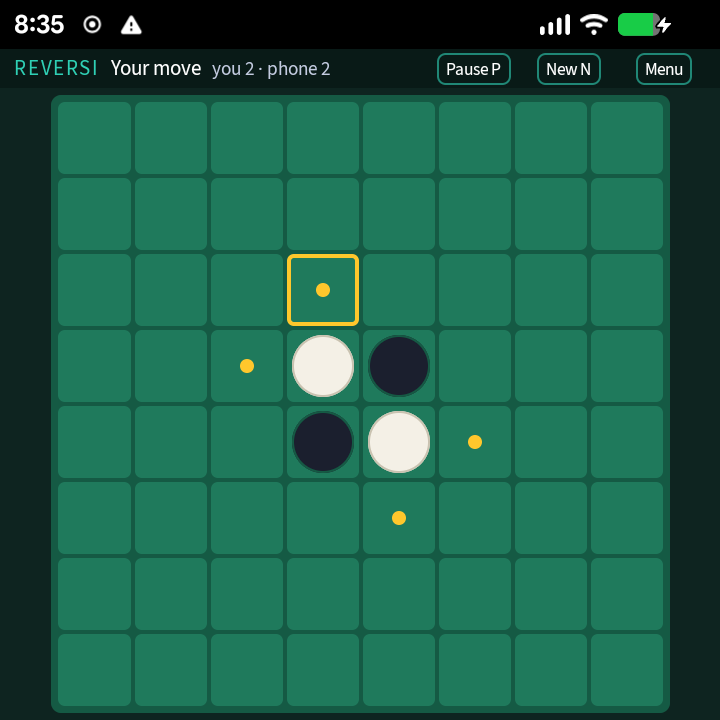

## Bitter Melons

A slingshot physics game. AI Slop has taken over the hills, and every level is a structure of glass, wood and stone with Slop on and inside it. Break every piece of Slop to clear the level.

- **Aim.** Up and down (W and S, or I and K on the Titan 2) set the angle, and left and right set the power. The dots show the start of the flight.
- **Target window.** While the structure is off screen, a window in the top right shows it and how far away it is. The aim arc runs into the window, and a red ring marks where the melon will first touch the structure or the ground. A low shot can touch down early and still roll into the structure.
- **Fire.** Space fires. Press Space again while the melon is in the air for a Seed Burst, three fast seeds in a spread.
- **Look ahead.** V (or Tab) moves the camera to the structure and back. Each level also opens with a short pan over it, and your first key press skips the pan.
- **Points.** A Slop App is worth 50, an AI Bot 100 and the gold Premium Ad-Slop 300. Breaking the gold one doubles block points for a few seconds. A red Overheated Battery blows up when hit, and its blast breaks what is near it. Each melon left over at the end is worth 500.
- **Seeds.** A cleared level earns one to three seeds by score, and the next level opens. A panel shows the result: press Space or tap for Next level, or Try again if you ran out of melons. N (Levels) shows the nine levels of a world with the seeds won on each; moving down past the last row goes on to the next world.
- **World 2, Slop Mall.** Clearing World 1's last level opens the mall. It brings the Split Cantaloupe, which splits into three smaller melons when you press Space in the air, and gold AD banners, which throw a melon off faster than it hit them. The melons waiting their turn sit at the bottom left, in the order they load.
- **World 3, Server Foundry.** Steel blocks, the orange Prompt Bot (150), and the Heavy Honeydew, which you slam straight down with Space. Cooling fans blow a melon upward while it is over them, and the aim dots and target ring follow the updraft. A steel beam hanging on cables drops when you hit it.
- **World 4, Storm Citadel.** The Overripe Melon bursts in a juice shockwave when you press Space, or when it hits something hard. Firewall shields ring the structures and stop melons: some break after enough hits, and others turn, so time your shot through the gap. Drone platforms hold Slop in the air until a hit breaks their thrusters.

## Sable Card Games

Sable Card Games opens on a menu of ten Indian card games. Arrows or the trackpad choose a game, Enter opens it and Back returns to the menu. In every game the arrows move, Enter confirms, Space selects, Del cancels and N starts over; touch works too. You play against phone players, and their names are drawn from names all over the world. Teen Patti uses practice chips only: they can't be bought, sold or won as anything else.

The players sit round a table, as people do: you at the bottom with your hand under the table, the others round the edge in the order they play. Each card lands in front of the player who played it and slides in from their seat, and the phone players take a moment over each card so you can follow them. In the trick games the trick just won stays on the table, dimmed, until the next card is played. Play goes clockwise (the next player sits on your left); press D on the menu, or tap the line under the title, to make it anticlockwise. The phone keeps your choice.

| Game | How to play | Keys |
| --- | --- | --- |
| Teen Patti | Three-card brag against three phone players, with practice chips only: they cannot be bought, sold or won as anything else. Play blind or look; chaal, raise, pack, or ask for a show | Left/Right and Enter choose; C chaal, R raise, T show, P pack, L or S look |
| Indian Rummy | 13 cards, two decks, a wild joker for the round. Declare with two sequences (one pure) and the rest in sets or sequences; a wrong declaration costs 80 points | Z draws from the stock, X takes the open card; Space picks a card up, then arrows move it; Enter throws; M declares; G groups your melds; O sorts |
| Filmi Rummy | The same rules as Indian Rummy with an original film theme: four invented roles in place of the suits and "plot twist" jokers. No real people or films | As Indian Rummy |
| Mendicot | Four players in partnerships, hidden trump (shown when someone cannot follow suit); win the tens | Left/Right choose a card; Enter plays |
| Callbreak | Bid the tricks you will win, over five rounds; spades are always trump | Up/Down set the bid; Left/Right and Enter play |
| Judgement | Bid exactly the tricks you will win; the trump suit changes every round and the last bidder may not make the bids add up | As Callbreak |
| 2-3-5 | Three players aim for 5, 3 and 2 tricks; the 5 player picks trump after the first five cards | Left/Right choose a suit or a card; Enter confirms |
| Bluff | Put cards down as the rank whose turn it is; call a bluff when you doubt it | Space picks up to four cards; Enter puts them down; B calls; Del clears |
| Donkey | Pass cards to get four of a kind, then grab a spoon before the others; the one left without gets a letter of D-O-N-K-E-Y | Left/Right choose; Enter passes; Space grabs |
| Gulam Choor | Take cards from the next player and throw pairs; whoever keeps the odd Jack loses | Left/Right choose a card; Enter takes it |

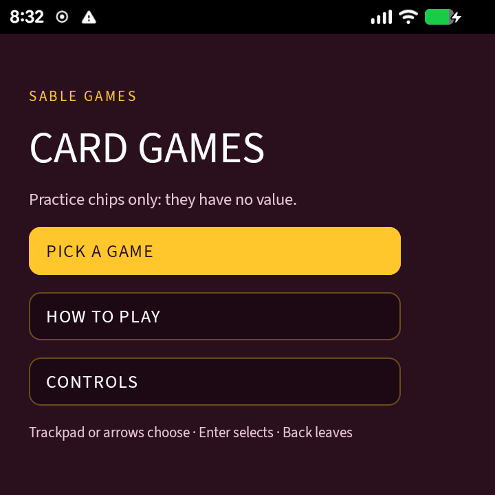

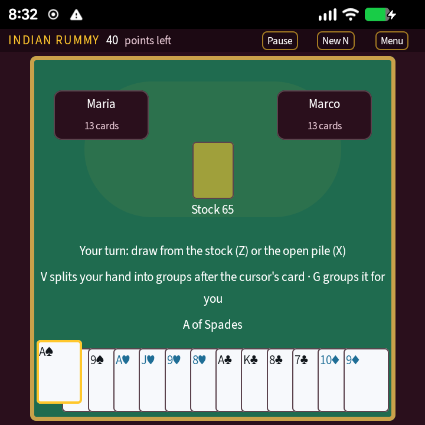
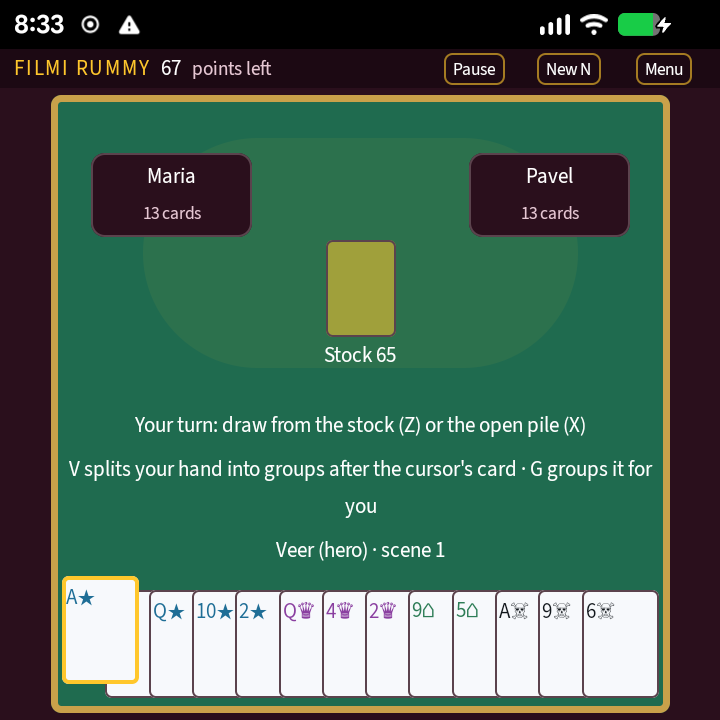
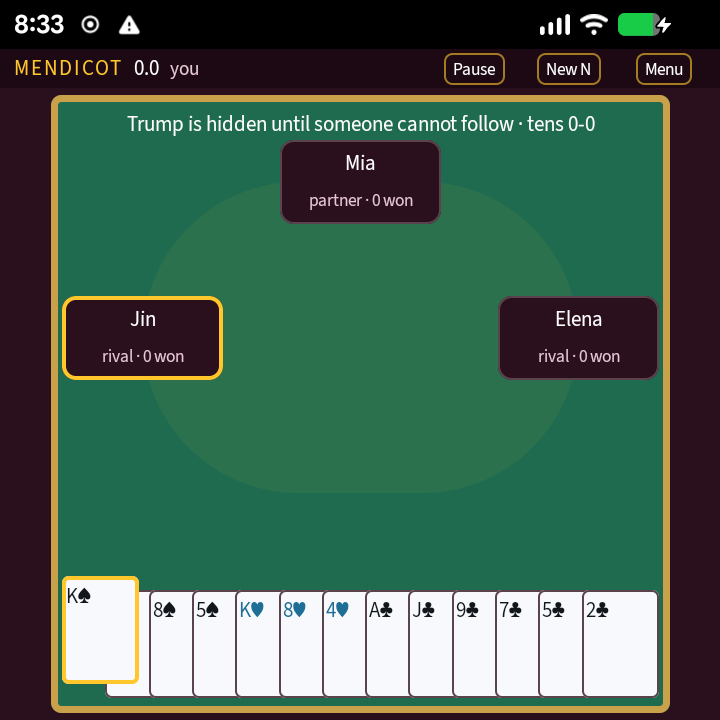
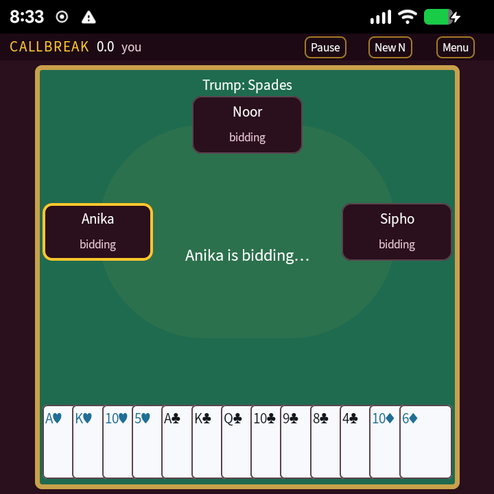
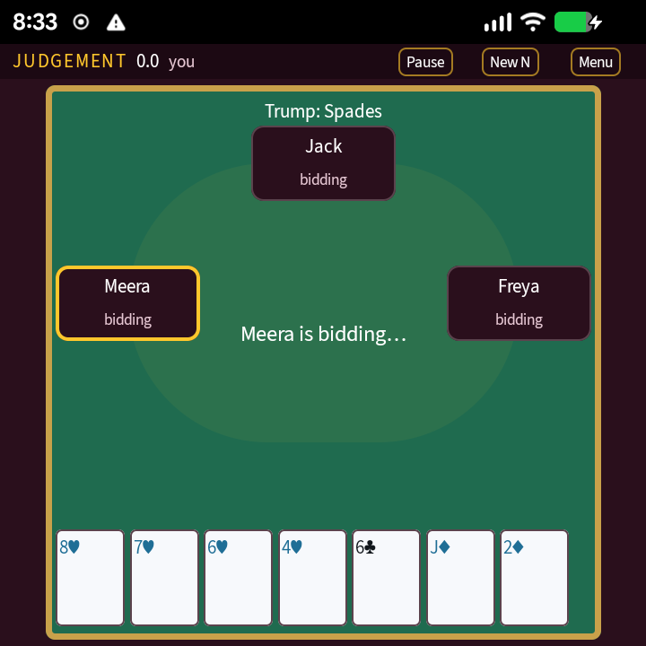
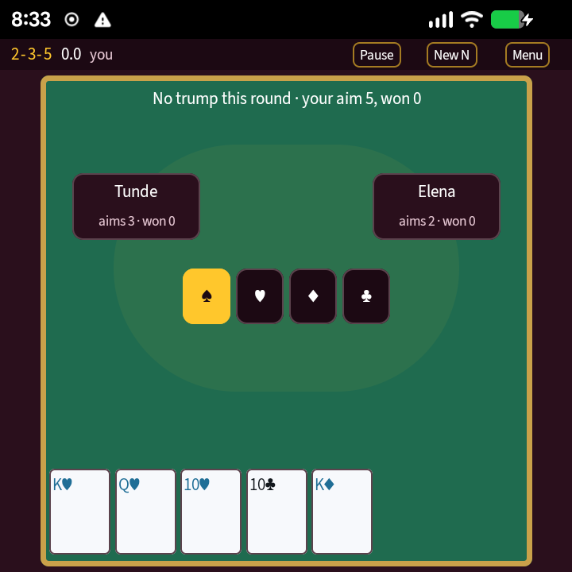
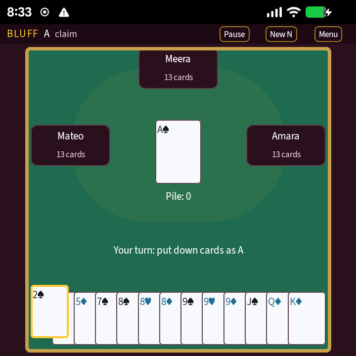
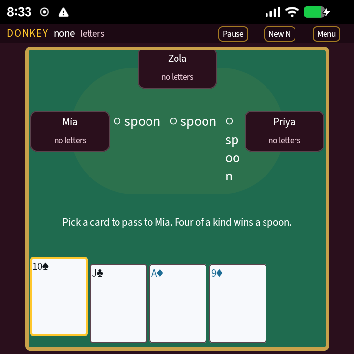
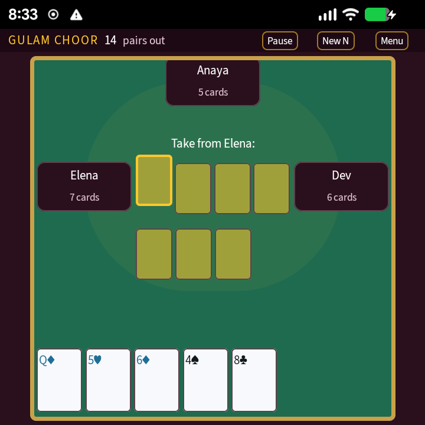

## Snakes & Ladders and Ludo

Each is an app of its own and opens straight into the game. Back leaves the app.

| Game | How to play | Keys |
| --- | --- | --- |
| Snakes & Ladders | 10 x 10 board with 8 ladders and 8 snakes, two to four players, exact finish on 100 | Space rolls; 2, 3, 4 set the number of players |
| Ludo | Four colours (you are red): a six brings a token out; capture, sixes and reaching home roll again | Space rolls and moves; Left/Right choose a token |

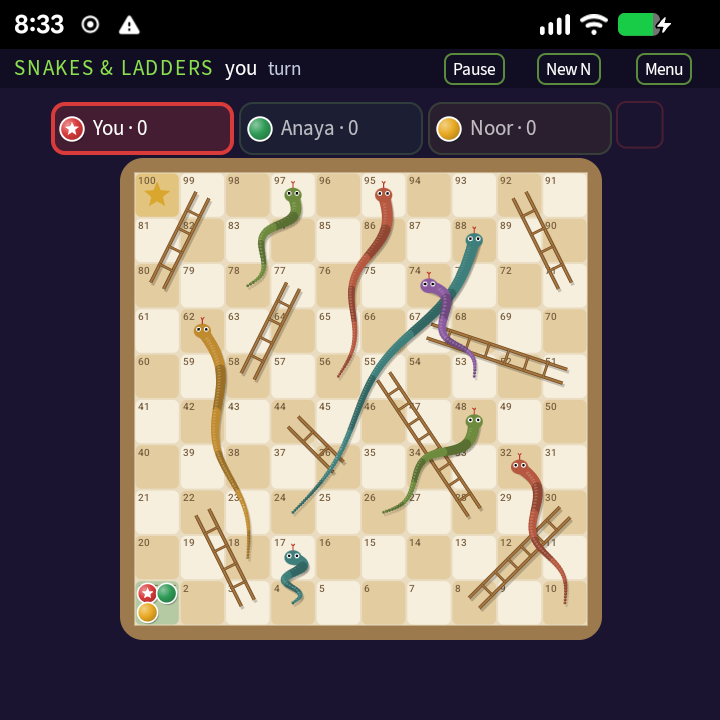

You can follow every turn. The phone players take about 1.2 seconds to roll, the dice tumbles before it shows the number, and each token walks square by square. Ladders climb, snakes slide, and captured Ludo tokens go back to their yard. Your tokens carry a white star. Each player's name and colour are shown: in Snakes & Ladders in a row of seats above the board with their square, and in Ludo on their yard with how many tokens are home. The player whose turn it is is outlined. Under the board, the last two moves are written out in the mover's colour, and the token that moved last keeps a soft halo and a faint trail. In Ludo, when you can move more than one token, a faint ghost shows where each would land.

## Sable Games Console

Sable Games Console plays games written as small Lua scripts, so new games can be added to the phone without rebuilding the app. It comes with eight games you play by tilting the phone. Each also plays with the trackpad, the arrow keys or W A S D.

| Game | How to play | Keys |
| --- | --- | --- |
| Tilt Maze | Roll the ball through the maze to the green square | Tilt, trackpad or W A S D roll; Space starts the level over |
| Motion 2048 | Every tile slides the way you tilt; equal tiles merge. One tilt, one slide | Tilt, trackpad or W A S D slide; level the phone between slides |
| Sokoban Tilt | Walk and push the crates onto the marks. One tilt, one step | Tilt, trackpad or W A S D walk; U undoes a step; Space starts the level over |
| Tilt Racer | Steer through the traffic without crashing; it gets faster the further you go | Tilt, or hold Left/Right (trackpad, A and D), to steer; Space boosts; C changes the colour of your F1 car, and the console remembers it |
| Tilt Circuit | Three laps against two rival cars, on the Easy oval (for starters, with slower rivals) or the Twisty circuit, chosen in a menu before each race and remembered; the menu shows your best time on each, and the library keeps your fastest race in seconds. The grass slows you down, and laps only count when you go all the way round | In the menu Up/Down picks a circuit and Space starts. Tilt, or hold Left/Right, to steer; lean back or hold Down (S) to brake; C changes the colour of your car |
| Ball Maze | Steel balls in a maze under a clear lid, like the hand-held toy: roll every ball into the middle at the same time. A menu picks a round or square board, plastic or wood, and Easy (2 balls) to Expert (5 balls); each game makes a new maze, and the library keeps your fastest time in seconds | Tilt, or hold the arrows (W A S D), to roll the balls; in the menu Up/Down and Left/Right choose and Space starts; N makes a new maze and M goes back to the menu |
| Sky Roll | Roll a ball across stone platforms floating in the sky: pick up the gems and reach the goal before the time runs out. Eight levels add bridges, wind that pushes you sideways, moving lifts and rails; roll off an edge and you lose one of four balls. The score is the gems and the seconds left | Tilt, or hold the arrows (W A S D), to roll; R starts the level again |
| Ramp Rush | A stunt car seen from behind, racing through a desert canyon at sunset. Ramps throw it over the gaps; in the air, leaning rolls the car, and each full roll you land takes a second off your time. Land on your wheels or go back to the last checkpoint. Three tracks; the library keeps your fastest total in seconds | Tilt, or hold Left/Right (A and D), to steer and to roll in the air; lean back or hold Down (S) to brake; Space boosts when the boost bar is full enough (landed rolls fill it); C changes the colour of your car |

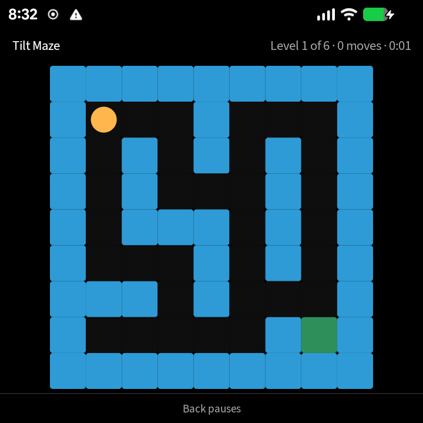
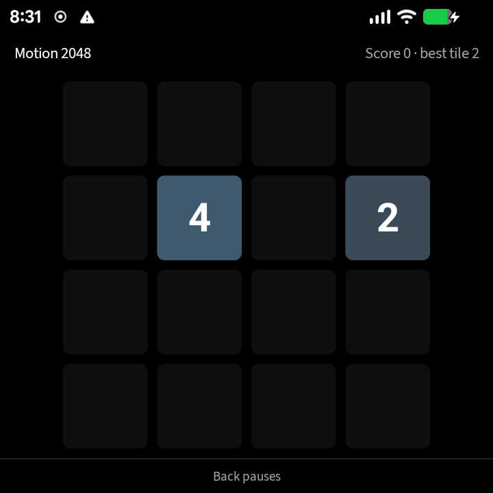
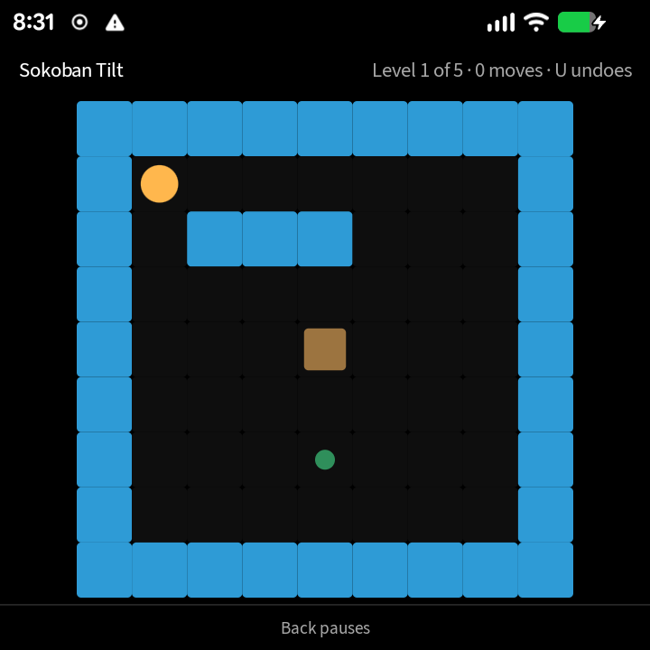
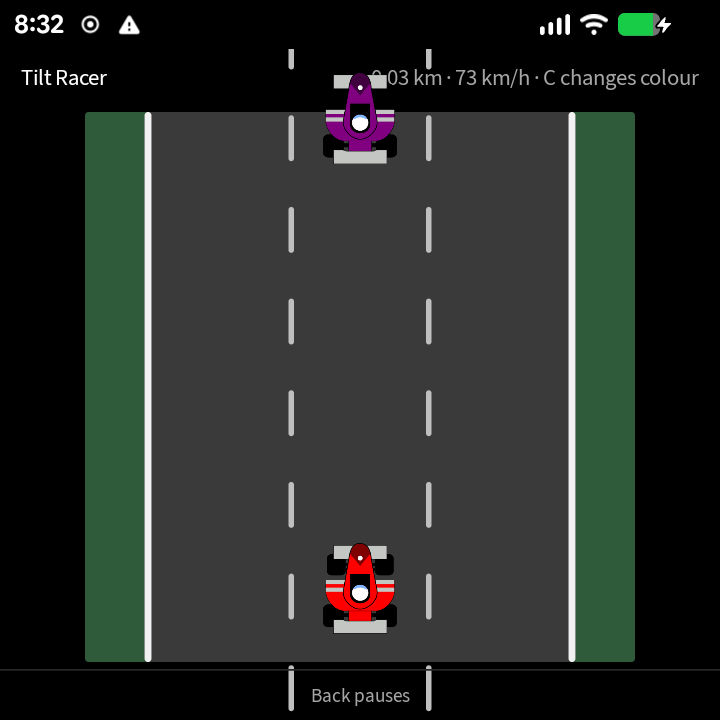
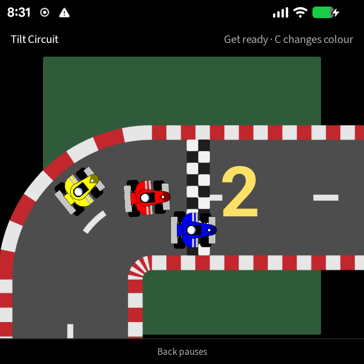
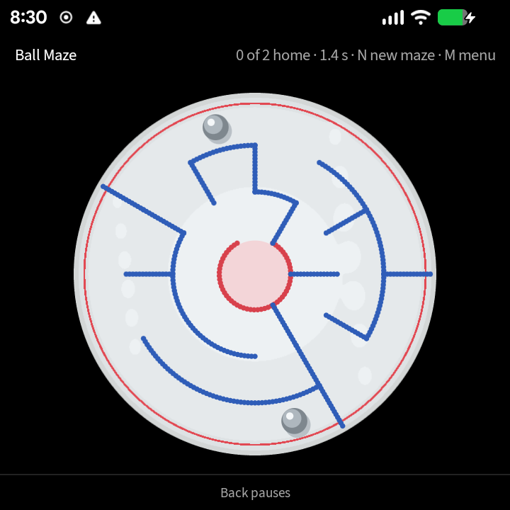
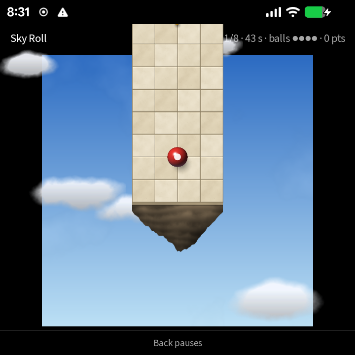
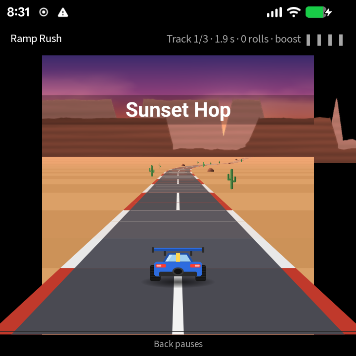

**The library.** Left and Right switch between the all, motion, puzzles, keyboard and recent tabs; Up and Down pick a game, and Space or Enter plays it. Each row shows the game's best score and a TILT or KEYS tag. I opens a game's details (best score, Reset progress, Remove for a game you added), A opens Add games and S opens Settings.

**Hold it how you'll play.** Before a tilt game starts, hold the phone the way you want to play and press Space: that angle becomes level, so you can play sitting up, lying back or with the phone flat on a table. K plays with the keys instead. One lean makes one step, and the next step needs the phone back near level, so a game never runs away from you.

**Pause.** Back (or P in a tilt game) pauses. The pause menu has a letter for each choice: R resume, N new game, L level again from where you are, T tilt sensitivity, K play with keys, Q quit to the library.

**Settings** (S in the library): T cycles tilt sensitivity (Low, Mid or High: a full turn takes a lean of about 45, 32 or 22 degrees; Mid is the default). A small wobble of the hand doesn't steer, and steering is gentle near level, so small leans make small corrections and K switches Play with keys on or off. The motion sensor is used only while a tilt game or the levelling screen is showing.

**Adding games.** Copy a game's folder to the phone, then in the library press A and choose the folder that holds it (or a folder of several games) in the system's folder picker. The app needs no storage permission: it only reads the folder you pick. It lists each game it finds; Enter adds one, and a game with a mistake shows what is wrong and on which line instead. Added games are copied into the app, so the folder can be deleted afterwards.

Each game is a folder with two files: `game.toml`, which names it (`id`, `name`, `entry`, and optionally `shelf`, `input`, `best`, `summary` and `controls`), and one `.lua` script, and it may also hold PNG pictures the game draws (up to 32, each at most 512 by 512 pixels). Games run in a sandbox with Lua's basic, text, table and maths libraries only: they cannot read or write files, use the network, run other programs or see your data. A game stuck in a loop, a runaway text search or a game that eats memory is stopped with a message, without harming the phone, and one game cannot change another or read its saves. Adding a game only copies its `game.toml`, its script and its PNG pictures into the console; nothing is installed. To make your own, follow the [step-by-step tutorial](GAMES_CONSOLE_TUTORIAL.md), which builds a small game and lists what games can and can't do; the full list of what a script can call is in [GAMES_CONSOLE.md](GAMES_CONSOLE.md).

